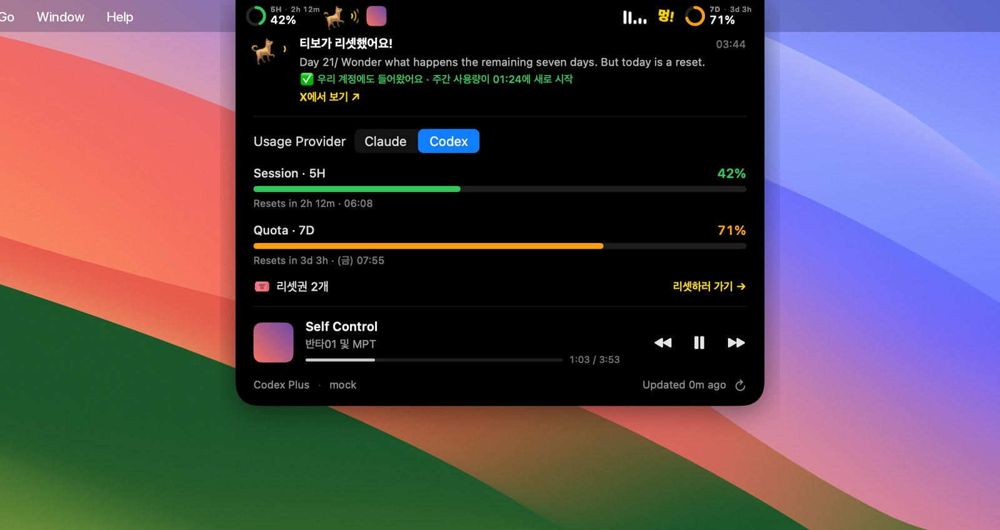

# 🐕 tibodog

> 티보가 리셋하면 짖는 개.
> A dog that barks when Tibo resets the limits.


```
      / \__            _______________
     (    O\___       |  WOOF! WOOF!  |
     /         O  <== | RESET! RESET! |
    /   (_____/       |_______________|
   /_____/   U
```

Tibo ([@thsottiaux](https://x.com/thsottiaux)) posts on X whenever the Codex usage limits get reset.
Run `npx tibodog` and:

- 🏝️ a **notch widget** comes up on macOS: your Claude Code or Codex usage on both sides of the notch,
  Now Playing next to it, and the dog
- 👀 it **watches Tibo's feed**, and when a reset post shows up
- 🐶 the dog **barks in the notch until you read it**, 🔊 barks out loud (a real recording), and 🔔 pops a
  notification

명령어 하나로 노치 위젯(사용량 · 음악 · 개)이 뜨고, 티보의 X를 감시하다가 리셋 글이 오면 개가 짖어요.

No npm dependencies. Node 18+. The widget needs macOS 14+ and Xcode Command Line Tools to build on first
run; on Linux and Windows tibodog still watches and barks in the terminal.

## 빠른 시작 / Quick start

```bash
npx tibodog --test        # 위젯 띄우고 바로 한번 짖어보기 / bring up the widget and bark once
```

> 아직 npm에 올리기 전이에요. 그동안은 `npx tibodog` 대신 `npx github:matthewkim-11/tibodog`을 쓰세요.
> Not on npm yet: use `npx github:matthewkim-11/tibodog` in place of `npx tibodog` for now.

The first run builds the widget into `~/.tibodog` (under a minute). After that it starts instantly and keeps
running even when you close the terminal. Then pick a way to read X:

### A) 공식 X API / Official X API

```bash
export X_BEARER_TOKEN=xxxxxxxx
npx tibodog
```

Reading a user timeline needs a paid X API tier. The default poll is every 5 minutes to stay
under rate limits. On a 429 the dog naps until the limit resets (the irony is noted).

### B) RSS 미러 / Any RSS mirror (free)

Any RSS/Atom feed of the account works: a Nitter instance, self-hosted [RSSHub](https://docs.rsshub.app)
(`/twitter/user/thsottiaux`), rss.app, and so on.

```bash
npx tibodog --rss "https://your-rsshub.example.com/twitter/user/thsottiaux"
```

## 옵션 / Options

| flag | default | |
|---|---|---|
| `--user <handle>` | `thsottiaux` | 감시할 계정 / account to watch |
| `--rss <url>` | | use an RSS feed instead of the X API |
| `--interval <sec>` | 60 (RSS) / 300 (X) | poll interval |
| `--keyword <text>` | | extra trigger phrase, repeatable |
| `--barks <n>` | 1 | 짖는 소리 반복 횟수 / times to play the bark |
| `--sound <file.wav\|synth>` | real recording | bring your own dog, or `synth` for the synthesized bark |
| `--lang <ko\|en>` | system locale | 표시 언어 / UI language |
| `--open` | off | open the post in the browser |
| `--no-widget` | | 노치 위젯 끄기 / don't start the notch widget |
| `--install-app` | | 위젯을 앱으로 설치 / install the widget as an app (below) |
| `--bark-old` | off | also bark at reset posts already in the feed on startup |
| `--once` | off | check once and exit (for cron) |
| `--test` | | just bark |

You can also set these through env vars: `TIBODOG_USER`, `TIBODOG_RSS`, `TIBODOG_INTERVAL`, `TIBODOG_SOUND`, `TIBODOG_LANG`.

## 언어 / Language

한국어(`ko`)와 영어(`en`)를 지원해요. 따로 지정하지 않으면 시스템 언어(`LANG`)를 따라가요.

```bash
npx tibodog --lang ko     # 멍! 멍멍! 리셋이다! 리셋!
npx tibodog --lang en     # WOOF! WOOF! RESET! RESET!
```

Order: `--lang` → `TIBODOG_LANG` → `LC_ALL` / `LC_MESSAGES` / `LANG` → system locale → `en`.
To add a language, add an entry to [`src/i18n.js`](src/i18n.js).

## 노치 위젯 / The notch widget (macOS)



- **Usage**: the 5-hour and weekly windows of Claude Code (the same numbers as `/usage`) or Codex, with
  reset timers. Hover the notch for details; switch between Claude and Codex there or in the menu.
- **Now Playing**: album art and dancing bars while music plays; hover for the track and controls. Works with
  anything that publishes to macOS Now Playing (Spotify, Apple Music, YouTube Music in Chrome, Safari...).
- **The dog**: on a reset, it barks beside the notch until you read it. Hover to see Tibo's post and a link;
  keep it open for a second and the dog goes back to sleep. A quick brush doesn't count. It survives restarts,
  so a reset you missed while away is still waiting for you.
- **Did the reset reach you?** The dog's card checks it against your Codex account: ✅ when your weekly
  window started over after Tibo's post, 🎟️ when it came as a reset credit, ⏳ while it hasn't yet. Codex is
  read every 10 minutes (even with Claude shown) and the changes are kept in `~/.tibodog/codex-history.json`.
  A new reset credit makes the dog bark too.
- **Reset credits** (Codex tab): how many you have, and **Use a reset →** to spend one through Codex's own
  `account/rateLimitResetCredit/consume`, after a confirm. It warns you when there's barely anything to reset.
- Right-click the island (or use the menu bar icon) for settings: provider, Now Playing, menu bar text,
  launch at login.

리셋이 오면 노치 옆에서 개가 계속 짖어요. 마우스를 올리면 티보의 글이 보이고, 1초쯤 읽고 떼면 개가 들어가요.
살짝 스치기만 하면 계속 짖어요. 사용량과 음악은 늘 보여요.

### 앱으로 설치 (선택) / Install as an app (optional)

`npx tibodog` is all you need. If you want the widget to start with your Mac even when tibodog isn't
running, install it as an app and turn on **Launch at Login** in its menu:

```bash
npx tibodog --install-app     # → /Applications/TiboDog.app
```

The X watching still runs in `tibodog`; the app shows usage and music on its own and barks when tibodog
reports a reset (they talk through `~/.tibodog/alert.json`).

### Usage sources

- **Claude Code**: reuses the Claude Code login already on your Mac (Keychain item `Claude Code-credentials`,
  read through `/usr/bin/security`, falling back to `~/.claude/.credentials.json`) and calls
  `api.anthropic.com/api/oauth/usage`. Refreshes an expired token the same way Claude Code does and writes it
  back; turn that off in the menu. Usage limits are a subscription feature, so API-key logins show nothing.
- **Codex**: starts the installed `codex app-server`, reads `account/rateLimits/read`, and closes it. Sign in
  to Codex with ChatGPT first. Set `TIBODOG_CODEX_PATH` if it lives somewhere unusual.
- **Now Playing** on macOS 15.4+ goes through the bundled
  [mediaremote-adapter](https://github.com/ungive/mediaremote-adapter) (BSD-3, in `app/Vendor/`). If Apple
  breaks it, music quietly disappears and the rest keeps working.

## 어떻게 판단하나 / How it decides

A post counts as a reset post when it has a reset word (`reset`, `resetting`, `refreshed`, `리셋`, `초기화`)
**and** a limits word (`limits`, `usage`, `rate`, `codex`, `weekly`, `사용량`, `한도`, ...).
See [`src/detect.js`](src/detect.js). If the dog barks at the wrong thing, send a PR with a test case.

On the first run it only records the posts already in the feed, so it won't bark at old ones.
Seen IDs are stored in `~/.tibodog/<user>.json`.

## 개발 / Development

```bash
npm test                    # the watcher
cd app && swift test        # the widget
cd app && make run          # build app/build/TiboDog.app and open it
```

Widget flags for development: `TIBODOG_DEBUG=1` (logs to stderr), `TIBODOG_MOCK=1` (sample data, no Keychain
or network), `TIBODOG_EXPANDED=1` (start expanded), `TIBODOG_SNAPSHOT=/path.png` (render and quit;
`make shots` in `app/`).

## Privacy

tibodog sends no conversations or files anywhere. It talks to X (or the RSS feed you give it), Anthropic for
Claude usage and token refresh, and OpenAI through the installed Codex app server. No analytics.

## 소리 출처 / Sound credits

The bundled bark is ["Barking of a dog"](https://commons.wikimedia.org/wiki/File:Barking_of_a_dog.ogg)
by Amada44 on Wikimedia Commons, licensed [CC BY-SA 3.0](https://creativecommons.org/licenses/by-sa/3.0/).
The audio file keeps that license. The code is MIT ([`LICENSE`](LICENSE); the widget in `app/` keeps Islet's notice in [`app/LICENSE`](app/LICENSE)). Details in [`sounds/CREDITS.md`](sounds/CREDITS.md).
The widget grew out of [Islet](https://github.com/aiasapkr-beep/islet), the same author's notch usage app.

The mockups in `docs/` use macOS Sonoma's default wallpaper, © Apple Inc.

## Disclaimer

A fan-made joke project. Not affiliated with OpenAI or X. Be nice to Tibo. 🐶

MIT
